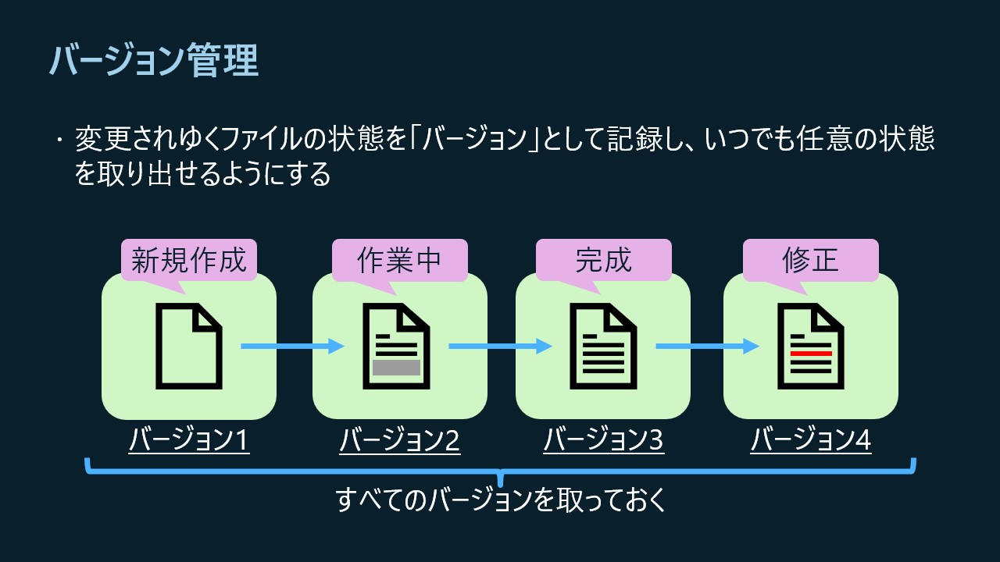
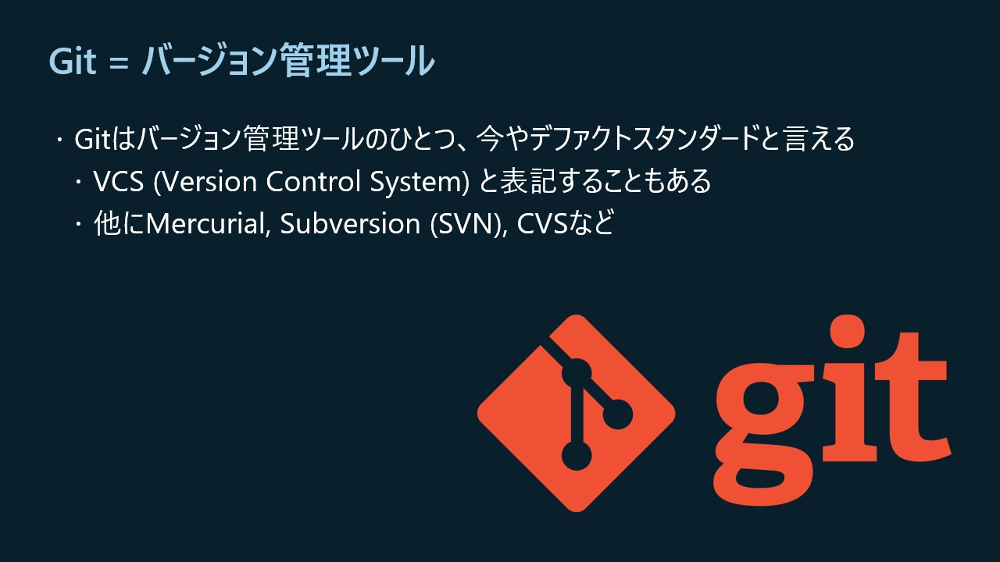
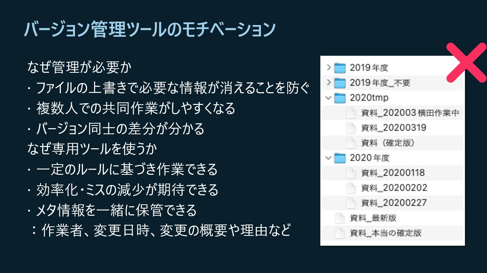
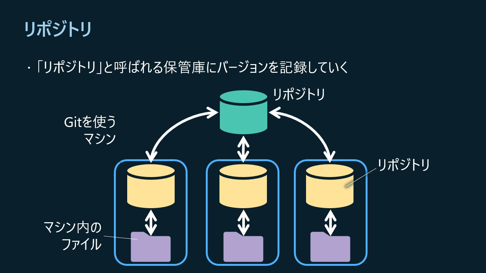
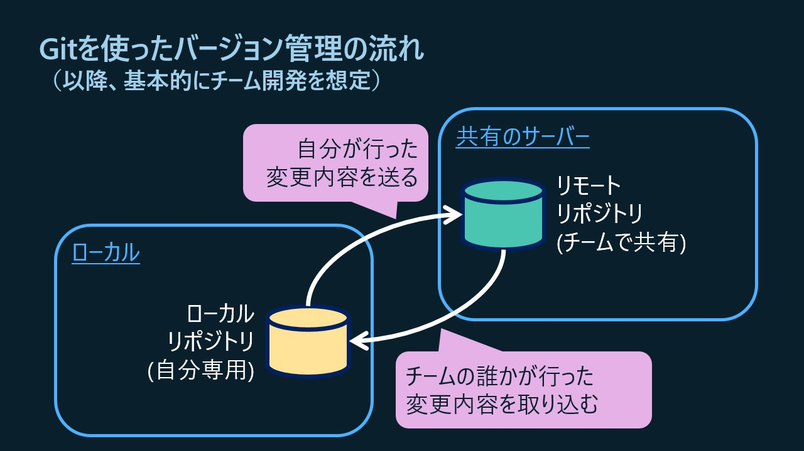
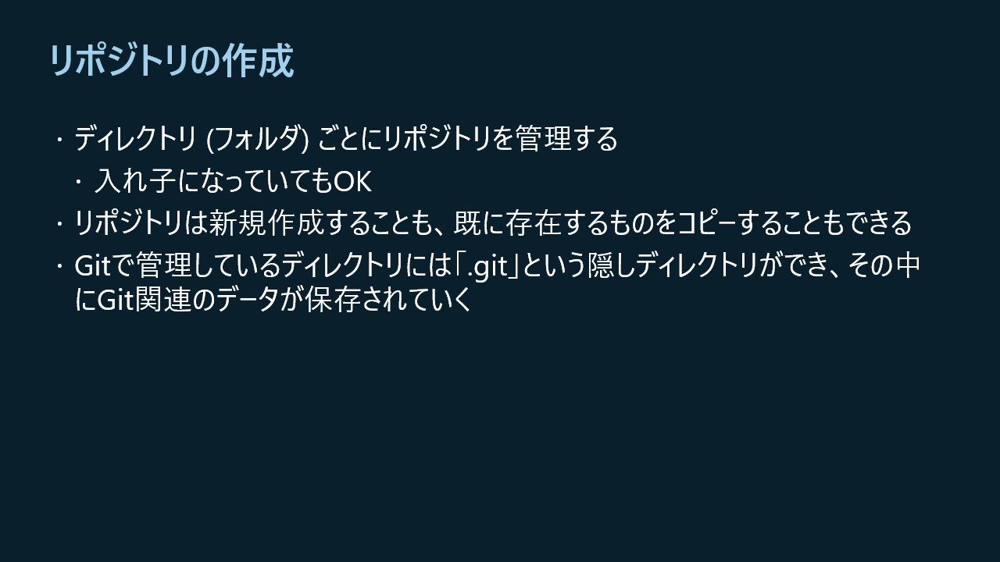
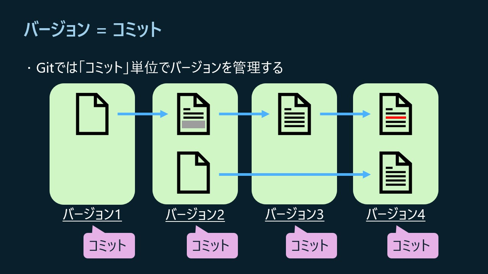
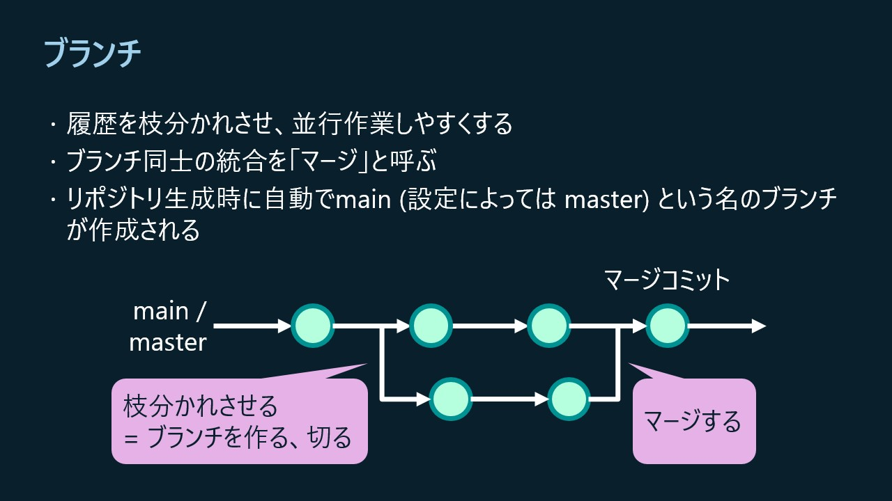
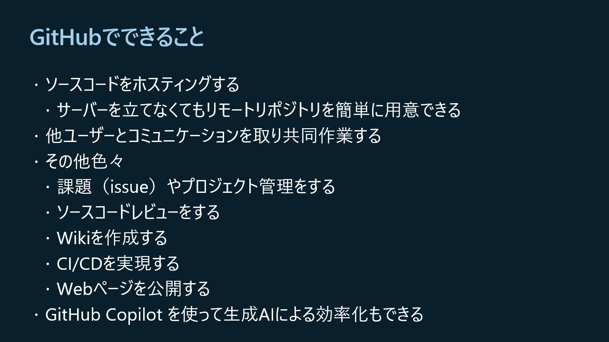

これはGitに馴染みがない方が基本的な考え方を「ざっくり」捉えるためのドキュメントです。勉強会を理解しやすくするための前提知識として確認してください。なお、実際の操作はGitHub Copilot（AI）を使って行うため、コマンドや手順などを把握する必要はありません。

----- 
Gitは、ファイルの変更を記録し、必要なときに過去の状態を確認・復元できるバージョン管理ツールです。

## 1. バージョン管理とは

ファイルを変更する過程でその状態を記録することをバージョン管理と言います。記録に残すことで、以前の状態を取り出したり、どこを変更したかを比べたりできます。

Gitは、現在広く使われているバージョン管理ツールのひとつです。

専用ツールを使ってバージョン管理を使う主な理由は次のとおりです。

- 誤った上書きで必要な情報が消えるのを防ぐ
- 複数人で作業しやすくする
- 変更前後の差分を確認できる
- 誰が、いつ、何を、なぜ変更したかを記録できる
- 一定のルールで作業し、効率化やミスの削減につなげる

## 2. リポジトリと基本の作業場所

**リポジトリ**は、Gitが変更履歴を保存する保管場所です。自分のパソコンにあるものを**ローカルリポジトリ**、GitHubなど共有サーバー上にあるものを**リモートリポジトリ**と呼びます。

チーム開発では、ローカルリポジトリで記録した変更内容を共有のリモートリポジトリへ送り、他の人の変更を自分のローカルへ取り込むことを繰り返しながら作業を進めます。

Gitではディレクトリ（フォルダー）ごとにリポジトリを管理します。新しく作ることも、既存のリポジトリをコピーして使い始めることもできます。

## 3. コミットで変更を記録する

Gitでは、ひとまとまりの変更履歴を **コミット（commit）** として記録します。コミットは「後から見返せる保存ポイント」のようなものです。Gitを使っていたら自動でコミットが作成されるわけではなく、どの変更をいつ記録するかは自分で決めます。

## 4. ブランチを使って並行作業する

**ブランチ（branch）** は、履歴を分岐させて並行作業するための仕組みです。機能追加や修正など、作業の意味やまとまりごとにブランチを作成し、切り替えながら使います。使用するブランチを指定すると、それ以降のコミットはそのブランチに追加されます。作業が終わったら、そのブランチで行った変更をほかのブランチに取り込むことができ、この操作を **マージ（merge）** と呼びます。  
リポジトリを作成すると `main` ブランチが用意され、そこから作業用ブランチを作るのが一般的です。

## 5. GitHubでリポジトリを共有する

**GitHub**は、Gitリポジトリをインターネット上でホストし、チームで共同作業するためのWebサービスです。先に紹介したリモートリポジトリを簡単に作れるサービスだと考えると分かりやすいです。  
https://github.com

ソースコードの共有に加え、課題（issue）やプロジェクトの管理、コードレビュー、Wiki、CI/CD、Webページの公開などにも使えます。GitHub Copilotによる開発支援も利用できます。

勉強会では、GitHub Flowと呼ばれる開発の流れを体験します。作業用ブランチで変更し、GitHubに共有して**プルリクエスト**を作成。レビュー後に `main` へマージします。